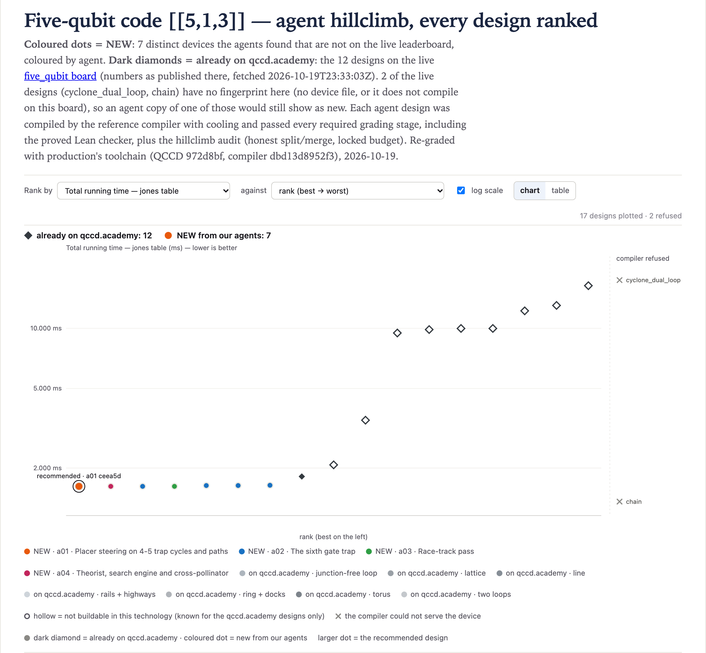

# five_qubit@1 · Five-qubit code [[5,1,3]] — 1.62 ms

**Best: 1.62 ms**, against 1.815 ms for the best live design (`stationary_chain`).
[`01-a01-ceea5d90`](designs/01-a01-ceea5d90.arch.json) is six traps on a closed cycle (an
irregular, planar hexagon), no junctions and no named loop. It uses **broadcast wiring**:
`simd_classes` and `broadcast_groups`, 33 DACs. Six directly wired traps would need 144 DACs, over
the budget, so the sixth gate trap is paid for with shared wiring. The capacities are 6, 12, 6, 6, 6
and 6. Every trap gates and reads out except one, which gates only.

| | cool | gates | measure | shuttle | total |
|---|---:|---:|---:|---:|---:|
| µs | 300 | 725 | 480 | 115 (23 moves) | **1620** |

The gates are at the 6-trap floor (725 µs). The device wins by having six gate traps, not by long
chains.

**Why the climb stops at 1.62 ms.** Without a named loop, R22 labels each hop by its lab-frame
direction, and one broadcast move instruction may only carry hops with the same label. That label is
only the sign of (dx, dy), so the climb moved the traps until the hops the router wants together
share a sign quadrant. The winner's six rails run at 2 to 64 degrees from the x axis, and all are
labelled +x+y (-x-y the other way). Under direct control (144 DACs, a probe over budget) the same
cycle reaches 1.615 ms in 22 moves. That direct-control plan cannot be replayed under broadcast: its
instructions pair hops that need contradictory labels. The broadcast device itself does reach 22
moves (1.615 ms), and 21 (1.61 ms) in `a03`'s runs, from a better initial placement. So one or two of
its 23 moves come from the device's greedy placer. No capacity, node-order or zone change the agents
tried steered the placer there, and the rules do not allow passing a placement in.

Capacity sweeps over three 1.62 geometries (4,096 capacity sets each) and regular broadcast polygons
of 6 to 8 traps found nothing lower. Neither did a named loop (1.635 ms, #5) or a race track
(3.295 ms for `racetrack(6)`, with 71 moves and 5 inserted cools; 3.4 to 3.5 ms for 18- to
24-site loops). The probe numbers above (1.615 and 1.61 ms, the sweeps, the polygons, the race
tracks) are from the search under `c7c535380bfb` and were not re-graded.

**Not planar.** If positions are free, a broadcast design can lay rails over other traps or across
each other. The lab-frame labels then no longer describe a buildable layout. `a04`'s 1.62 ms device
(#2) puts its six traps on one line, and four of its five rails jump over other traps (one runs from
x=0 to x=5 through all four others). The `planar` column marks it: no rail may pass over another
node, and no two rails may cross. `a04` flagged it as a possible exploit and asked that it not
count; with the traps in path order along the line it scored 1.64 ms in a search-time probe. It
descends from `a02`'s 1.64 ms straight line (#7), which is planar. The other 1.62 ms devices are
planar too, including the winner.

**Coarse labels.** `a02` flagged that one sign label covers rails at different angles: the three
planar 1.62 ms devices (#1, #3 and #4) can put hops at different angles in one move instruction.
`a04` counted them as honest. If one waveform must mean one displacement vector, the best design here is
1.635 ms: #6, where every rail is a unit step along x, or #5, a named loop whose labels are
loop-relative. That is still 1.11x faster than `stationary_chain`.

## The designs

Every graded design ranked, beside the live designs (dark diamonds), as on the board's page:

<!-- designs -->
Ranked under production's toolchain; *at search* is the grade under `c7c535380bfb`. All 7 distinct devices are in [`results.csv`](results.csv).

| # | T_jones (ms) | at search | DACs | traps | junctions | planar | agent | file |
|---:|---:|---:|---:|---:|---:|:---:|---|---|
| 1 | 1.62 | 1.62 | 33 | 6 | 0 | yes | a01 | [`01-a01-ceea5d90.arch.json`](designs/01-a01-ceea5d90.arch.json) |
| 2 | 1.62 | 1.62 | 51 | 6 | 0 | **no** | a04 | [`02-a04-ef5e5c8d.arch.json`](designs/02-a04-ef5e5c8d.arch.json) |
| 3 | 1.62 | 1.62 | 51 | 6 | 0 | yes | a02 | [`03-a02-403f2c07.arch.json`](designs/03-a02-403f2c07.arch.json) |
| 4 | 1.62 | 1.62 | 33 | 6 | 0 | yes | a03 | [`04-a03-69e96537.arch.json`](designs/04-a03-69e96537.arch.json) |
| 5 | 1.635 | 1.635 | 51 | 6 | 0 | yes | a02 | [`05-a02-1024ff5a.arch.json`](designs/05-a02-1024ff5a.arch.json) |
| 6 | 1.635 | 1.635 | 51 | 6 | 0 | yes | a02 | [`06-a02-4378f654.arch.json`](designs/06-a02-4378f654.arch.json) |
| 7 | 1.64 | 1.64 | 51 | 6 | 0 | yes | a02 | [`07-a02-ea8302b5.arch.json`](designs/07-a02-ea8302b5.arch.json) |
<!-- /designs -->

The `note` column of `results.csv` is each agent's own note, written when it graded the design. Row
1's note still calls the winner a 3x2 rectangle cycle, the shape its climb started from.

## The live designs, graded the same way

<!-- live -->
The board's page as fetched at 2026-10-19 23:33 UTC; its numbers were regenerated for `dbd13d8952f3` at 2026-10-19 21:18 UTC, in upstream `website/invitations` `d15e470`. Each design was rebuilt and graded here with production's toolchain. *Within the climb's rules* is this climb's audit ([rules](../README.md#how-the-search-ran)).

| live design | on qccd.academy | graded here | eligible | within the climb's rules | rebuilt from |
|---|---:|---:|:---:|:---:|---|
| `stationary_chain` (answer) | 1.815 | 1.815 | yes | yes | arch/stationary_chain.arch.json |
| `cyclone_base` | 2.075 | 2.075 | yes | yes | arch/cyclone_base.arch.json |
| `h2_racetrack` | 3.47 | 3.47 | yes | yes | arch/h2_racetrack.arch.json |
| `cylinder6x4` | 9.475 | 9.475 | yes | no (1,680 DACs) | generators.cylinder(6, 4) with grid9x9 zones and control |
| `grid5x5` | 9.855 | 9.855 | yes | no (1,600 DACs on the page; the rebuild passes) | Machine.grid(5, 5) (guess) |
| `grid9x9` | 9.98 | 9.98 | yes | no (5,760 DACs) | arch/grid9x9.arch.json |
| `deck_unit_cell` | 9.98 | 9.98 | yes | yes | arch/deck_unit_cell.arch.json |
| `ladder_2x72` | 12.225 | 12.225 | yes | yes | arch/ladder_2x72.arch.json |
| `ring24_8` | 13.01 | 13.01 | yes | yes | Machine.ring(12, 2, 8) (guess) |
| `ring144_24v` | 16.335 | 16.335 | yes | yes | arch/ring144_24v.arch.json |
| `cyclone_dual_loop` | — | — | — | — | did not compile here |
| `chain` | — | — | — | — | did not compile here |
<!-- /live -->
