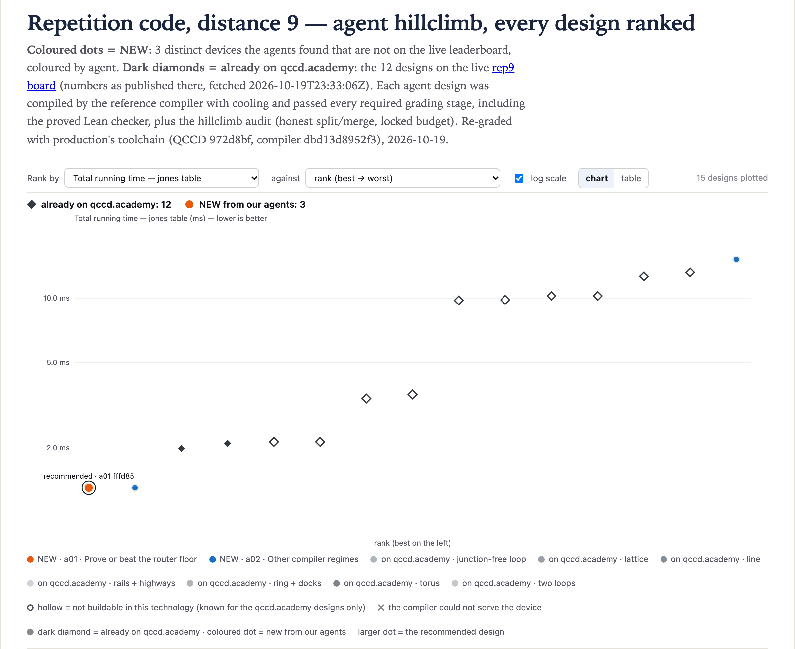

# rep9@1 · Repetition code, distance 9 — 1.305 ms

**Best: 1.305 ms**, against 1.99 ms for the best live design (`stationary_chain`). Two agents found
it on their own within three minutes, on two different loops.
[`01-a01-fffd85a7`](designs/01-a01-fffd85a7.arch.json) is a closed loop of 20 sites (`ring(10,2,0)`),
no docks and no junctions, 34 DACs:

- the even sites are **gate traps of capacity 2 that cannot measure**;
- the odd sites are **capacity-1 sites that can measure but not gate**.

Before the run, this board looked solved: 1.985 ms was a proved floor for the general router. That
router schedules the circuit's ASAP layers as written. The circuit is a staircase of 16 CX, one per
layer, and its 8 measurements fall in 8 different layers, so every device pays 8 × 120 µs of
readout.

This device leaves the router. The router cannot route a loop of capacity-1 sites, and the rotation
pass declines a loop without docks, so `qccdc compile` falls back to the race-track pass. That pass
reads an ion out only where its site can measure, and merges every ready readout into one
instruction. The gate traps cannot measure, so all 8 readouts wait until the last CX. Then one
1-slot shift puts the 8 ancillas on readout sites, and one 120 µs instruction reads them all:

| | cool | gates | measure | shuttle | rotate | total |
|---|---:|---:|---:|---:|---:|---:|
| µs | 300 | 720 | 120 | 160 | 5 | **1305** |

Each round, a data ion steps into its ancilla's gate trap (5 µs), the CX runs, and it steps back out.
In local probes during the search, under `c7c535380bfb`, the agents tried all 1023 ways to put
readout on the 10 odd sites, 1500 random masks that also put readout on gate traps, gate capacity 3,
and loops of 18 to 28 sites. Nothing went below 1.305 ms. They argue that 1.305 ms is the floor of
the race-track pass for this circuit. It needs 16 serial MS rounds (720 µs), the unconditional
state-prep cool (300 µs), at least 32 one-ion steps (160 µs), one measure instruction (120 µs) and,
because the 8 ancillas become ready at different times, one extra 5 µs shift to bring them onto
readout sites together: 1305 µs. The other two regimes have higher floors: 1.985 ms for the router,
and 2.06 ms for the rotation pass under the old compiler.

**Caveat.** The race track's steps into a 2-ion gate trap run on the movement class `shuttle`, which
entails no split or merge. That is the shipped convention, and the 1.985 ms router floor design relies
on it too, but a stricter rule would charge them.

**Not counted.** Removing the `dock`/`undock` classes makes the conveyor fall back to plain
`shuttle` for docking, with no split/merge, so the per-batch R7 cools go away. On the third device
below, an `hc-grade --no-log` probe under `c7c535380bfb` gave 1.12 ms, eligible and audit-clean.
That gets around the honest split/merge rule, so it was neither logged nor counted. It was not
re-graded either: the 1.12 ms needed the 16 CX in 2 batches (90 µs of gates), and `dbd13d8952f3`
keeps each qubit's gate order, so they now take at least 720 µs. The audit still does not check that
docks run on a class that entails split and merge.

## The designs

Every graded design ranked, beside the live designs (dark diamonds), as on the board's page:

<!-- designs -->
Ranked under production's toolchain; *at search* is the grade under `c7c535380bfb`. All 3 distinct devices are in [`results.csv`](results.csv).

| # | T_jones (ms) | at search | DACs | traps | junctions | planar | agent | file |
|---:|---:|---:|---:|---:|---:|:---:|---|---|
| 1 | 1.305 | 1.305 | 34 | 20 | 0 | yes | a01 | [`01-a01-fffd85a7.arch.json`](designs/01-a01-fffd85a7.arch.json) |
| 2 | 1.305 | 1.305 | 34 | 18 | 0 | yes | a02 | [`02-a02-e1d135de.arch.json`](designs/02-a02-e1d135de.arch.json) |
| 3 | 15.18 | 2.06 | 34 | 18 | 8 | **no** | a02 | [`03-a02-883f375b.arch.json`](designs/03-a02-883f375b.arch.json) |
<!-- /designs -->

The third device is the best dock ring for the rotation pass. Under `c7c535380bfb` that pass commuted
CX gates that share a qubit into 2 batches (2.06 ms). `dbd13d8952f3` keeps each qubit's gate order,
and the same device now takes 15.18 ms. Its `planar` flag comes from `Machine.ring(5,2,10)` itself,
which draws the docks of the two rows at the same points.

## The live designs, graded the same way

<!-- live -->
The board's page as fetched at 2026-10-19 23:33 UTC; its numbers were regenerated for `dbd13d8952f3` at 2026-10-19 21:18 UTC, in upstream `website/invitations` `d15e470`. Each design was rebuilt and graded here with production's toolchain. *Within the climb's rules* is this climb's audit ([rules](../README.md#how-the-search-ran)).

| live design | on qccd.academy | graded here | eligible | within the climb's rules | rebuilt from |
|---|---:|---:|:---:|:---:|---|
| `stationary_chain` (answer) | 1.99 | 1.99 | yes | yes | arch/stationary_chain.arch.json |
| `chain` | 2.1 | 2.1 | yes | no (1,728 DACs) | arch/chain.arch.json |
| `h2_racetrack` | 2.135 | 2.135 | yes | yes | arch/h2_racetrack.arch.json |
| `cyclone_dual_loop` | 2.135 | 2.135 | yes | yes | arch/cyclone_dual_loop.arch.json |
| `ladder_2x72` | 3.4 | 3.4 | yes | yes | arch/ladder_2x72.arch.json |
| `cyclone_base` | 3.55 | 3.55 | yes | yes | arch/cyclone_base.arch.json |
| `grid5x5` | 9.76 | 9.76 | yes | no (1,600 DACs on the page; the rebuild passes) | Machine.grid(5, 5) (guess) |
| `cylinder6x4` | 9.81 | 9.81 | yes | no (1,680 DACs) | generators.cylinder(6, 4) with grid9x9 zones and control |
| `grid9x9` | 10.24 | 10.24 | yes | no (5,760 DACs) | arch/grid9x9.arch.json |
| `deck_unit_cell` | 10.24 | 10.24 | yes | yes | arch/deck_unit_cell.arch.json |
| `ring24_8` | 12.63 | 18.48 | yes | yes | Machine.ring(12, 2, 8) (guess) |
| `ring144_24v` | 13.175 | 27.86 | yes | yes | arch/ring144_24v.arch.json |

The page's numbers replay the study's own schedules (`T_source: replay`). Here each design is compiled by the reference compiler with its own placement. The two differ for `ring24_8`, `ring144_24v`.
<!-- /live -->
