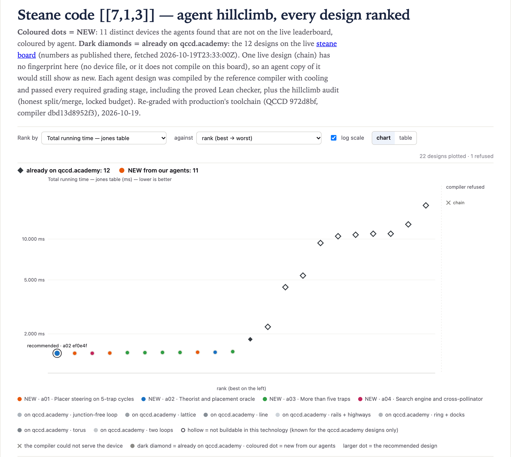

# steane@1 · Steane code [[7,1,3]] — 1.44 ms

**Best: 1.44 ms**, against 1.825 ms for the best live design (`stationary_chain`). Three agents
reached it with three different devices.
[`01-a02-ef0e4f76`](designs/01-a02-ef0e4f76.arch.json) is five traps on a closed cycle, no junctions,
no named loop and direct wiring, 120 DACs. Every trap can gate, read out and cool. In cycle order the
capacities are 4, 8, 13, 5, 4, and the segment capacities 1 to 3.

| | cool | gates | measure | shuttle | total |
|---|---:|---:|---:|---:|---:|
| µs | 300 | 470 | 600 | 70 (14 move instructions) | **1440** |

It does not win through long chains. The placer starts by filling the three smallest traps (4, 4 and
5 ions) and leaves the traps of capacity 13 and 8 empty as meeting rooms.

**The floor.** The general router spends at least 1.370 ms on any device: the state-prep cool, at
least 470 µs of gates (layer 2 holds 5 CX, so 5 gate traps; with 4 or fewer the gates cost at least
515 µs, so the total is at least 1.415 ms) and 600 µs of readout in 5 measure layers. With 5 or
more traps, no single assignment of ions to traps serves all the circuit's ASAP layers, and they
split at best into 7 windows that each have one. That forces at least 6 move instructions, so
**`T_jones ≥ 1.400 ms` for any device**.

**Why the climb stops at 1.44 ms.** With `--init-placement` (analysis only, never graded), the winner
itself reaches 1.430 ms in 12 move instructions. The same cycle with capacities 5, 4, 5, 5, 4 (same
order) reaches 1.425 ms in 11, though its own placer gives 1.485 ms. The device cannot reach these
placements, because the placer minimises weighted interaction distance and then swap-climbs it. The
good placements score high on that objective and are not swap-local minima. On a 5-cycle every pair
of traps is 1 or 2 apart, so a device cannot reshape the objective. About 30 independent device
climbs found nothing lower. Neither did two capacity sweeps (1,024 and 7,776 devices) or a joint
placement-and-capacity search.

Broadcast wiring needs a different layout. Broadcast cycles of 5 to 15 traps with uniform capacities
reach 1.57 ms at best, and a03's broadcast circles of 6 to 10 traps 1.505 ms. a03's "lens" cycles
reach 1.455 ms with 101 DACs, with 5 traps and also with 7. A lens relies on R22 labelling a hop off
a named loop only by the sign of (dx, dy): every hop is +x+y or -x-y, though the 5-trap lens's rails
run at 18 to 79 degrees. R22 does not apply to the direct-wired winner.

The times and move counts in these two paragraphs that are not in the tables come from local probes
during the search, under `c7c535380bfb`, and were not re-graded.

No exploits were found on this board.

## The designs

Every graded design ranked, beside the live designs (dark diamonds), as on the board's page:

<!-- designs -->
Ranked under production's toolchain; *at search* is the grade under `c7c535380bfb`. All 11 distinct devices are in [`results.csv`](results.csv).

| # | T_jones (ms) | at search | DACs | traps | junctions | planar | agent | file |
|---:|---:|---:|---:|---:|---:|:---:|---|---|
| 1 | 1.44 | 1.44 | 120 | 5 | 0 | yes | a02 | [`01-a02-ef0e4f76.arch.json`](designs/01-a02-ef0e4f76.arch.json) |
| 2 | 1.44 | 1.44 | 120 | 5 | 0 | yes | a01 | [`02-a01-319ea4c6.arch.json`](designs/02-a01-319ea4c6.arch.json) |
| 3 | 1.44 | 1.44 | 120 | 5 | 0 | yes | a04 | [`03-a04-c22e6d3b.arch.json`](designs/03-a04-c22e6d3b.arch.json) |
| 4 | 1.445 | 1.445 | 120 | 5 | 0 | yes | a01 | [`04-a01-5e40df96.arch.json`](designs/04-a01-5e40df96.arch.json) |
| 5 | 1.455 | 1.455 | 101 | 5 | 0 | yes | a03 | [`05-a03-5c91455c.arch.json`](designs/05-a03-5c91455c.arch.json) |
| 6 | 1.455 | 1.455 | 101 | 7 | 0 | yes | a03 | [`06-a03-dcf4e122.arch.json`](designs/06-a03-dcf4e122.arch.json) |
| 7 | 1.46 | 1.46 | 101 | 5 | 0 | yes | a03 | [`07-a03-77114b1f.arch.json`](designs/07-a03-77114b1f.arch.json) |
| 8 | 1.46 | 1.46 | 101 | 6 | 0 | yes | a03 | [`08-a03-468f2415.arch.json`](designs/08-a03-468f2415.arch.json) |
| 9 | 1.465 | 1.465 | 120 | 5 | 0 | yes | a01 | [`09-a01-cf7d91d2.arch.json`](designs/09-a01-cf7d91d2.arch.json) |
| 10 | 1.465 | 1.465 | 120 | 5 | 0 | yes | a02 | [`10-a02-31097917.arch.json`](designs/10-a02-31097917.arch.json) |
<!-- /designs -->

The notes in [`results.csv`](results.csv) are the agents' own, written at grading time. Row 1's note
that the device placer reaches the init-placement oracle predates the 1.430 ms placement above.

## The live designs, graded the same way

<!-- live -->
The board's page as fetched at 2026-10-19 23:33 UTC; its numbers were regenerated for `dbd13d8952f3` at 2026-10-19 21:18 UTC, in upstream `website/invitations` `d15e470`. Each design was rebuilt and graded here with production's toolchain. *Within the climb's rules* is this climb's audit ([rules](../README.md#how-the-search-ran)).

| live design | on qccd.academy | graded here | eligible | within the climb's rules | rebuilt from |
|---|---:|---:|:---:|:---:|---|
| `stationary_chain` (answer) | 1.825 | 1.825 | yes | yes | arch/stationary_chain.arch.json |
| `cyclone_base` | 2.255 | 2.255 | yes | yes | arch/cyclone_base.arch.json |
| `h2_racetrack` | 4.42 | 4.42 | yes | yes | arch/h2_racetrack.arch.json |
| `cyclone_dual_loop` | 5.38 | 5.38 | yes | yes | arch/cyclone_dual_loop.arch.json |
| `cylinder6x4` | 9.35 | 9.35 | yes | no (1,680 DACs) | generators.cylinder(6, 4) with grid9x9 zones and control |
| `grid5x5` | 10.49 | 10.49 | yes | no (1,600 DACs on the page; the rebuild passes) | Machine.grid(5, 5) (guess) |
| `ring24_8` | 10.75 | 20.13 | yes | yes | Machine.ring(12, 2, 8) (guess) |
| `grid9x9` | 10.945 | 10.945 | yes | no (5,760 DACs) | arch/grid9x9.arch.json |
| `deck_unit_cell` | 10.945 | 10.945 | yes | yes | arch/deck_unit_cell.arch.json |
| `ladder_2x72` | 12.83 | 12.83 | yes | yes | arch/ladder_2x72.arch.json |
| `ring144_24v` | 17.695 | 44.78 | yes | yes | arch/ring144_24v.arch.json |
| `chain` | — | — | — | — | did not compile here |

The page's numbers replay the study's own schedules (`T_source: replay`). Here each design is compiled by the reference compiler with its own placement. The two differ for `ring24_8`, `ring144_24v`.
<!-- /live -->
