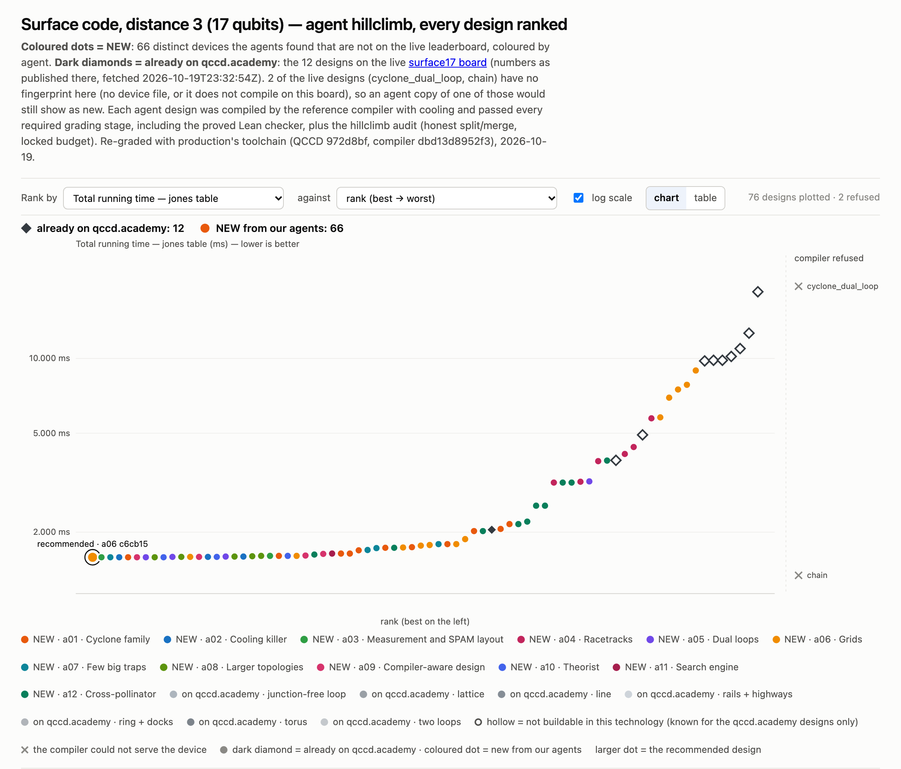

# surface17@1 · Surface code, distance 3 — 1.585 ms

**Best: 1.585 ms**, against 2.045 ms for the best live design (`stationary_chain`). The board's page
showed `cyclone_base` at 3.89 ms as its best when the run started. Nine agents reached 1.585 ms, with
nine different devices. [`01-a06-c6cb1514`](designs/01-a06-c6cb1514.arch.json) is five traps on a
closed cycle. Every node has degree 2, so there is no junction anywhere. Its plain segments sit on no
named loop, and it uses direct wiring, 120 DACs. In cycle order the capacities are 6, 4, 3, 4 and 8.
One trap, the 4 between the 6 and the 3, gates only and has no readout. With no conveyor declared,
the router runs free: ions on one cycle may move in different directions.

| | cool | gates | measure | shuttle | total |
|---|---:|---:|---:|---:|---:|
| µs | 300 | 485 | 720 (6 instructions) | 80 (16 transport instructions) | **1585** |

Its longest chain is 8 ions. a06 reads this as the win not coming from long chains; a02 thinks big
chains help keep routes short. How it got there (grades at search time):

| step | ms |
|---|---:|
| `cyclone_base` | 3.89 |
| the loop shrunk to `ring(2,2,0)` | 1.64 |
| direct wiring, no named loop | 1.605 |
| a 4-trap cycle, capacities searched | 1.595 |
| a 5-trap cycle | 1.59 |
| node ids, node order and segment order searched | 1.585 |

**The floor.** The router puts the circuit into 11 ASAP layers: 9 with CNOTs and 6 with
measurements. It emits one measure instruction per layer, so readout costs at least 6 × 120 µs, and
the gate rounds are fixed too. With the state-prep cool, that is **1.505 ms + 5 µs per transport
instruction** on any device. Layers 0, 3 and 5 hold four gate operations each, and every gate claims
its trap (R12), so at least 4 traps must be able to gate. A 3-trap triangle needs only 14 or 15
transports, but its gates split into extra rounds (685 µs).

One agent, a06, ran ten processes of an evolutionary search over n-trap cycles for about two hours,
each at about 30 devices a second, scored by a local copy of the search compiler. Every process
plateaued at 16 transports with 5 traps, or 18 with 4. With `--init-placement` (local probes, never
graded) the same devices need 13 or 14, so a06 concludes that most of what is left is in the placer,
not the device.

**Why grids lose.** In `grid(a,b)` with a, b ≥ 2, every lattice node that is not a corner has degree
3 or 4, so it is a junction (R18). Only `grid 2x2`, whose four nodes are all corners, has none. On
`grid 4x4`, 46 transport instructions cost 4,735 µs and force 10 cools (3,000 µs). Even `grid 2x3`,
with two junctions, takes 5.79 ms. That is about 4 ms more than the 6-trap ring #31 (1.69 ms) with
almost the same number of transports (38 against 37), and about 2 ms more than `cyclone_base`.

**The picks.** Seven designs were chosen as `bingran-agent-1` to `-7` for the official board (not
submitted). The `file` column marks them. They cover one each of: a 5-trap cycle, a 4-trap cycle, a
4-trap loop with shared control, a 6-trap ring, a 3-trap triangle, a 14-trap ring and a 2×3 junction
grid.

**Board-wide caveat.** The router moves ions with the seed's `shuttle` class, which entails no split or
merge. An ion that joins or leaves a multi-ion chain pays neither. The designs here rely on this
convention, and so do the live ones. a02 estimated, under the search compiler, that with split and
merge charged, its own 1.595 ms 4-cycle (`1792303625-a02-e049dedc`, in `results.csv`) would take
7.18 ms (10 cools, plus R14 `gate_swap` violations) and `cyclone_base` 23.5 ms. Neither number was
graded.

**Not counted.** Several agents noted levers they did not use:

- `control.model = "direct"` with broadcast wiring, or fewer `electrodes_per_trap`, which would fit 6
  or more independently driven traps under 128 DACs;
- traps at the same coordinates, which give every hop one lab-frame label.

The audit now rejects both: direct control pays 24 DACs per trap, and no segment may join two nodes
at the same position.

## The designs

Every graded design that passed the audit, ranked beside the live designs (dark diamonds, hollow
when not buildable), as on the board's page:

Two more devices, a06's direct-wired `grid(2,3)` and `grid(3,3)` at 168 and 288 DACs, failed the
128-DAC budget at search time. They are not in the chart, the table or `results.csv`.

`planar` checks the positions as written: no rail passes over another node and no two rails cross.
Design #4 draws its 5-cycle with one rail crossing two others. It is directly wired, so R22 does not
apply and positions do not label its hops.

The `note` column of `results.csv` and the `description` in each design file are the agents' own
words. The files and tools they name, such as `a10/NOTES.md` or `tools/ufast.py`, were the agents'
working files and are not in this PR. Where a note and a column disagree, the column is the graded
value: the note on #22 says 96 DACs, and the device grades at 128.

<!-- designs -->
Ranked under production's toolchain; *at search* is the grade under `c7c535380bfb`. All 66 distinct devices are in [`results.csv`](results.csv).

| # | T_jones (ms) | at search | DACs | traps | junctions | planar | agent | file |
|---:|---:|---:|---:|---:|---:|:---:|---|---|
| 1 | 1.585 | 1.585 | 120 | 5 | 0 | yes | a06 | [`01-a06-c6cb1514.arch.json`](designs/01-a06-c6cb1514.arch.json) (pick `bingran-agent-1`) |
| 2 | 1.585 | 1.585 | 120 | 5 | 0 | yes | a03 | [`02-a03-9cfe336c.arch.json`](designs/02-a03-9cfe336c.arch.json) |
| 3 | 1.585 | 1.585 | 120 | 5 | 0 | yes | a07 | [`03-a07-ba61074c.arch.json`](designs/03-a07-ba61074c.arch.json) |
| 4 | 1.585 | 1.585 | 120 | 5 | 0 | **no** | a02 | [`04-a02-b62db835.arch.json`](designs/04-a02-b62db835.arch.json) |
| 5 | 1.585 | 1.585 | 120 | 5 | 0 | yes | a01 | [`05-a01-4b1ab42a.arch.json`](designs/05-a01-4b1ab42a.arch.json) |
| 6 | 1.585 | 1.585 | 120 | 5 | 0 | yes | a09 | [`06-a09-b7294b0b.arch.json`](designs/06-a09-b7294b0b.arch.json) |
| 7 | 1.585 | 1.585 | 120 | 5 | 0 | yes | a05 | [`07-a05-314e4fe0.arch.json`](designs/07-a05-314e4fe0.arch.json) |
| 8 | 1.585 | 1.585 | 120 | 5 | 0 | yes | a08 | [`08-a08-514dae97.arch.json`](designs/08-a08-514dae97.arch.json) |
| 9 | 1.585 | 1.585 | 120 | 5 | 0 | yes | a10 | [`09-a10-21b071f8.arch.json`](designs/09-a10-21b071f8.arch.json) |
| 10 | 1.59 | 1.59 | 120 | 5 | 0 | yes | a05 | [`10-a05-32a80970.arch.json`](designs/10-a05-32a80970.arch.json) |
| 16 | 1.595 | 1.595 | 96 | 4 | 0 | yes | a05 | [`16-a05-b97f148c.arch.json`](designs/16-a05-b97f148c.arch.json) (pick `bingran-agent-2`) |
| 26 | 1.625 | 1.625 | 33 | 4 | 0 | yes | a12 | [`26-a12-72db22fe.arch.json`](designs/26-a12-72db22fe.arch.json) (pick `bingran-agent-3`) |
| 31 | 1.69 | 1.69 | 33 | 6 | 0 | yes | a01 | [`31-a01-97dace38.arch.json`](designs/31-a01-97dace38.arch.json) (pick `bingran-agent-4`) |
| 37 | 1.74 | 1.74 | 33 | 3 | 0 | yes | a01 | [`37-a01-cc3fdcbb.arch.json`](designs/37-a01-cc3fdcbb.arch.json) (pick `bingran-agent-5`) |
| 49 | 2.205 | 2.205 | 34 | 14 | 0 | yes | a12 | [`49-a12-8d6d049a.arch.json`](designs/49-a12-8d6d049a.arch.json) (pick `bingran-agent-6`) |
| 62 | 5.79 | 5.79 | 33 | 7 | 2 | yes | a06 | [`62-a06-a4fba55e.arch.json`](designs/62-a06-a4fba55e.arch.json) (pick `bingran-agent-7`) |
<!-- /designs -->

## The live designs, graded the same way

<!-- live -->
The board's page as fetched at 2026-10-19 23:32 UTC; its numbers were regenerated for `dbd13d8952f3` at 2026-10-19 21:18 UTC, in upstream `website/invitations` `d15e470`. Each design was rebuilt and graded here with production's toolchain. *Within the climb's rules* is this climb's audit ([rules](../README.md#how-the-search-ran)).

| live design | on qccd.academy | graded here | eligible | within the climb's rules | rebuilt from |
|---|---:|---:|:---:|:---:|---|
| `stationary_chain` (answer) | 2.045 | 2.045 | yes | yes | arch/stationary_chain.arch.json |
| `cyclone_base` | 3.89 | 3.89 | yes | yes | arch/cyclone_base.arch.json |
| `h2_racetrack` | 4.925 | 4.925 | yes | yes | arch/h2_racetrack.arch.json |
| `grid5x5` | 9.77 | 9.77 | yes | no (1,600 DACs on the page; the rebuild passes) | Machine.grid(5, 5) (guess) |
| `grid9x9` | 9.83 | 9.83 | yes | no (5,760 DACs) | arch/grid9x9.arch.json |
| `deck_unit_cell` | 9.83 | 9.83 | yes | yes | arch/deck_unit_cell.arch.json |
| `cylinder6x4` | 10.18 | 10.18 | yes | no (1,680 DACs) | generators.cylinder(6, 4) with grid9x9 zones and control |
| `ladder_2x72` | 10.95 | 10.95 | yes | yes | arch/ladder_2x72.arch.json |
| `ring24_8` | 12.635 | 26.94 | yes | yes | Machine.ring(12, 2, 8) (guess) |
| `ring144_24v` | 18.54 | 37.69 | yes | yes | arch/ring144_24v.arch.json |
| `cyclone_dual_loop` | — | — | — | — | did not compile here |
| `chain` | — | — | — | — | did not compile here |

The page's numbers replay the study's own schedules (`T_source: replay`). Here each design is compiled by the reference compiler with its own placement. The two differ for `ring24_8`, `ring144_24v`.
<!-- /live -->
