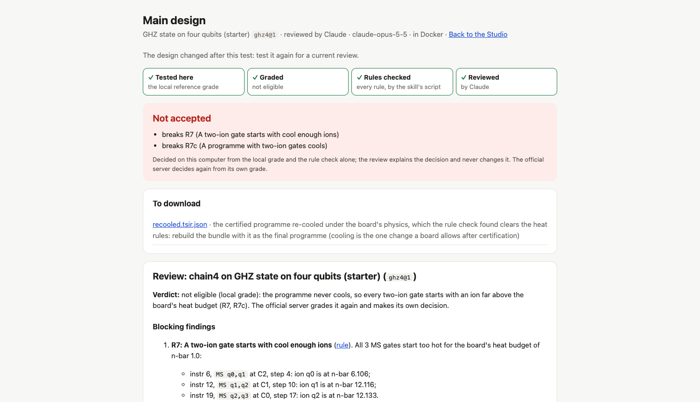

# Agent review of a design

A person reviews a design on their own computer before they submit it: the design-review skill's
rule check decides at once, and their own coding agent -- Claude Code or Codex, signed in with
their own subscription -- explains the decision: what fails, where, and how to fix it. The
official server decides again from its own grade, and never from a review written where it cannot
see.

## The experience

One button for the person, one tool for their agent, the same review behind both.

1. **Test on the board** (exists): the Studio's Leaderboard panel, `qccd submit --local`, or an
   agent's `qccd_submit_local` compiles the board's circuit onto the design and grades it.
2. **Review it here.** The panel's "2 · Review it here" (or `qccd review`, or an agent's
   `qccd_review`): the person picks who reviews -- Claude, ChatGPT or no agent -- and where it runs
   (in its CLI's sandbox on this computer, or in Docker). The **decision** comes within seconds:
   *Accepted*, *Not accepted* (with every reason), *Held for a maintainer*, or *Not decided on this
   computer* (a tool missing here, never the design's fault). Then the **review**: the agent reads
   the skill and the rule check and writes what fails, where (instruction, site, rail), and how to
   fix it, while the panel follows it. The review page (`/reviewview/<review>`) holds the
   decision, the review, the re-cooled programme to download when the heat rules fail, and every
   rule's verdict.
3. **Signing in, when it is needed.** A reviewer that is not signed in shows "Sign <it> in for
   reviews": its CLI's own sign-in starts on this computer and the page shows its link (and
   Codex's code; Claude's page shows a code to paste back into the panel). Once per reviewer, for
   this computer and Docker alike. An agent is never asked for a code: its tool says what the
   person does.
4. **Submit.** With a reviewer picked, Submit reviews the design here first (unless that very test
   is already reviewed) and sends it when the review is done; an agent's `qccd_submit_official`
   does the same before the person's card asks them. The upload asks the server for its own
   decision; the person may send a review written in Docker along, marked as theirs.
5. **The server decides.** It grades the bundle again, runs the same rule check, and makes the same
   decision from its own grade (`X-QCCD-Reviewer: none`: no agent, no key). Its page
   (`/review/<submission>`) shows that decision, every rule, and the submitter's review, marked as
   unchecked.



## The decision is never the agent's

`decide()` (`qccd/review/engine.py`) makes it from two things only: the grade and the
deterministic rule check (`review.py --bundle --report --no-grade`), before any agent starts. A
review that fails, times out or disagrees leaves it standing; two people with the same design get
the same decision whichever agent they chose; text inside a design cannot talk an agent into
accepting it. The person's computer and the server run the same function, so the decision here
matches the server's unless a tool is missing here.

## How it runs

```
Studio · qccd review · qccd_review ─▶ workspace `review` job (qccd/workspace/reviews.py)
                                         │  engine.run_review (qccd/review/engine.py)
                                         ├─ stage a folder outside the workspace: bundle, grade, skill, out/
                                         ├─ rule check (limited child) ─▶ decision        (seconds)
                                         └─ agent CLI ─▶ review.md, progress               (minutes)
                                              sandbox: its CLI's own   docker: container.py
Studio Submit ─▶ review here first ─▶ upload (X-QCCD-Reviewer: none) ─▶ server: grade ─▶ decision
                                                     (+ the submitter's Docker review, if sent)
```

- `qccd/review/agents.py`: the reviewers, their profiles and sign-in, the sandboxed command.
- `qccd/review/engine.py`: one review -- stage, rule check, decision, the agent.
- `qccd/review/container.py` and `deploy/review/`: Docker isolation -- the image, the review's
  own network, the egress proxy.
- `qccd/workspace/reviews.py`: the workspace's review job, its records, the Studio's sign-ins.
- `qccd/official/review.py`: the server's own decision (and, with a key, its own agent).
- Workspace API: `POST /api/reviews`, `GET /api/reviews/{id}`, `GET /api/reviewers`,
  `POST /api/reviewers/{reviewer}/signin`, `/reviewview/{id}`; the MCP tool `qccd_review`; the
  CLI `qccd review [run|login|status|use]`, `qccd submit --local --review`, `qccd publish --review`.
- Server API: `POST /v1/submissions/{id}/submitter-review` (the owner), and the review endpoints.

## Signing the reviewers in

Each reviewer runs from a **profile of its own** in `~/.qccd/reviewers/` (`QCCD_HOME` moves it):
a person's usual agent home carries their own instructions, memories, plugins, MCP servers and
hooks into every session (Codex reads `~/.codex/AGENTS.md` whatever else is switched off), and a
review must see none of that. The profile is signed in once, and the person's usual sign-in is
untouched.

| Reviewer | Sign in once | Kept as | Used by |
|---|---|---|---|
| ChatGPT (Codex) | `qccd review login codex` (browser), or the Studio's button (device code) | `reviewers/codex/auth.json` (a file, never the keyring) | this computer and Docker |
| Claude (Claude Code) | `qccd review login claude` (`claude setup-token`), `--token` for one it printed before, or the Studio's button | `reviewers/claude/oauth-token` (readable by this user only) | this computer and Docker (`CLAUDE_CODE_OAUTH_TOKEN`) |

A person who would rather pay by the token sets `QCCD_REVIEW_ANTHROPIC_API_KEY` or
`QCCD_REVIEW_OPENAI_API_KEY`: the key goes to that agent's process and nothing else.

This is a person running their own Claude Code and Codex on their own computer, with their own
subscription -- what the workspace's chat agents already do. QCCD never sees a password, never
sends a token anywhere, and never runs one person's sign-in for another. A public server cannot do
that: "Unless previously approved, Anthropic does not allow third party developers to offer
claude.ai login or rate limits for their products, including agents built on the Claude Agent
SDK" (the Agent SDK's documentation), and a ChatGPT plan reaches third-party apps only through
OpenAI's Sign in with ChatGPT. So the server needs no agent at all: it decides from its grade.

## Isolation

- **sandbox** (the default): the CLI's own OS sandbox -- Codex's `workspace-write` (Seatbelt on
  macOS, Landlock on Linux) with the network off and approvals never; Claude Code's sandbox
  (Seatbelt or bubblewrap) with no network, writes only in `out/`, credential folders unreadable,
  `--permission-mode dontAsk`, only the Bash, Read, Glob, Grep, Write and Edit tools. Neither reads
  the person's config, rules or memories. The environment holds the CLI's profile and nothing else.
- **docker**: a container per review, from the image built once from `deploy/review/` (the two
  CLIs at pinned versions, Python with numpy, the egress proxy; about a minute the first time). It
  sits on a Docker network of its own, `--internal`, so it has no route out; a proxy container on
  that network and the default one lets CONNECT through to its model's API hosts only, port 443
  only, and logs every request (the review keeps the hosts let through and refused). The container
  has a read-only root, no capabilities, no new privileges, pid, memory and CPU limits, the
  person's uid, and sees the review's folder, its profile, and the checkout's `qccd/` and `arch/`
  (read-only) -- nothing else of the computer. A token or key goes in by name, never in an argv.

What leaves the computer: nothing, by default. A review is sent with a submission only when the
person asks, only one written in Docker (where the agent saw nothing of this computer but its own
folder), and only with nothing in it that looks like a credential (`engine.find_secrets`, checked
again by the server).

## For agents

- `qccd_review(design, board, wait_s=50)` (or `submission_id`): the decision, the reasons, the
  review's text and every failing rule; `qccd_review(review_id, wait_s=50)` waits again on one
  still running. A reviewer that is not signed in is refused with what the person does.
- `qccd_submit_official` reviews first when the person picked a reviewer; the card shows it.
- The co-design skill (`qccd/workspace/skill/SKILL.md`) tells the agent to review a failing test
  and to fix the blocking findings before asking to publish.
- The reviewer is a fresh session in its own profile, never the agent that designed the device:
  no shared context, and it does not mark its own work.

## Try it on this computer

From a clone, with Python 3.10 or newer:

```bash
python3 -m venv .venv && source .venv/bin/activate
pip install -e ".[agent,official]"                     # the workspace, the grader's simulators, the server
python -m qccd.workspace toolchain build-checker       # the Lean checker on a Mac (needs Lean: brew install elan-init)
qccd review login codex                                # once: ChatGPT, for reviews
qccd review login claude                               # once: Claude (claude setup-token), for reviews
qccd init my-designs && cd my-designs
qccd submit --local --board GHZ --wait                 # a test of the main design on the GHZ board
qccd review --board GHZ --reviewer claude              # the decision, then Claude's review, here
qccd review --board GHZ --reviewer codex --isolation docker   # Codex, in Docker
qccd studio                                            # the same from the Leaderboard panel
```

`qccd review use claude --isolation docker` makes those the defaults (the Studio's choice too);
`qccd review status` says who is ready. To try the whole round trip, `python -m qccd.official.devstack`
runs the server on this computer, and prints the `QCCD_OFFICIAL_URL` and `QCCD_CREDENTIALS` a
Studio submits there with. A Studio's own test needs the compiler: `qccd toolchain install`
fetches it, or says how to build it where this version has no prebuilt one. Without the Lean
checker, a design that passes everything else is *Not decided on this computer*.

Tests: `tests/test_local_review.py` (the review here, the doors, Submit, Docker, the egress proxy,
signing in) and `tests/test_agent_review.py` (the server), with a stand-in agent.
